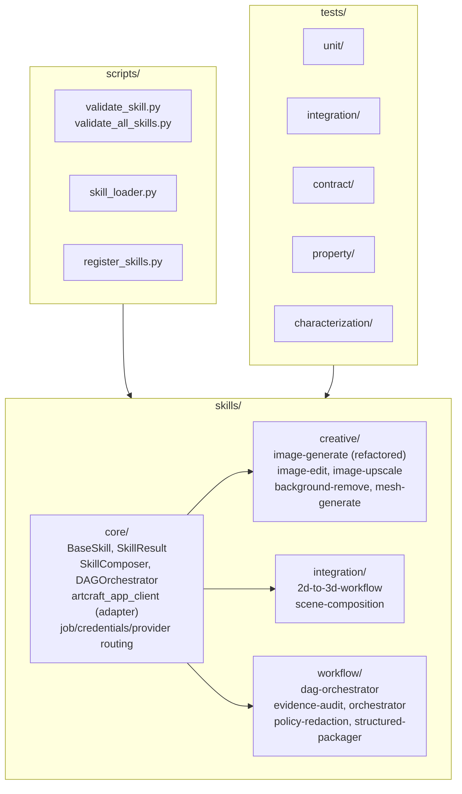
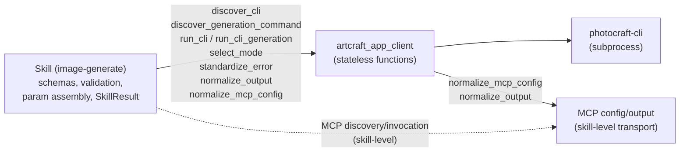
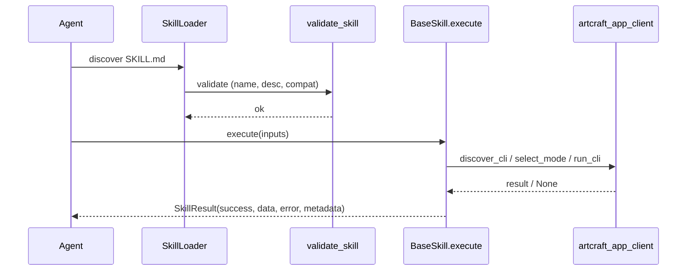

# Architecture

High-level structure of the ArtCraft Skills Suite.

## System Overview

## Adapter Data Flow (003)

## Skill Execution Lifecycle

## Key Conventions

- Skills are `SKILL.md` (YAML frontmatter + body) under `skills/{category}/{name}/`.
- Python skills subclass `BaseSkill` and return `SkillResult`.
- Composition via `SkillComposer` (sequential/parallel) and `DAGOrchestrator`.
- Adapter is function-based, stateless; no `ArtcraftAppClient` class.
